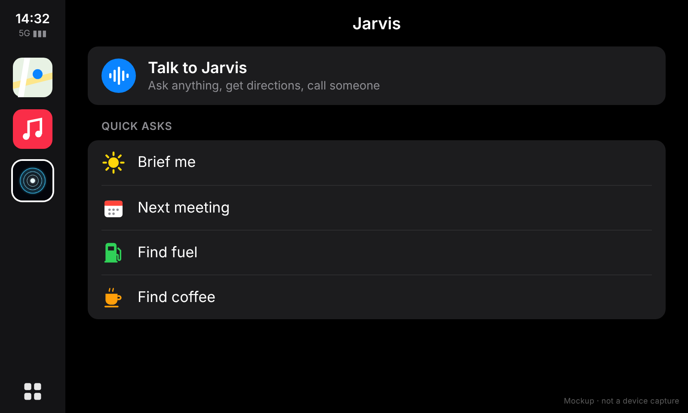
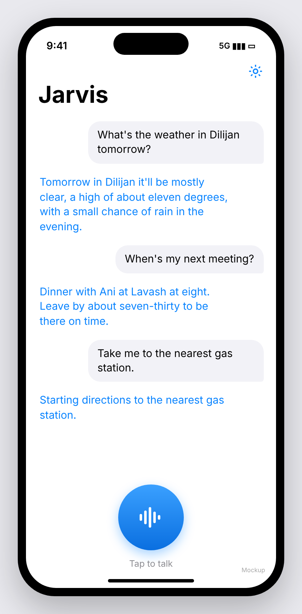

# Jarvis for CarPlay

A hands-free voice assistant for the car. Open **Jarvis** on the CarPlay screen and it starts listening
straight away (Apple requires voice-first for this app category); the list behind it has *Talk to Jarvis*
and quick asks like *Brief me* for the next conversation. Jarvis answers out loud, can keep a back-and-forth going, and can start
Apple Maps directions or place a call. The phone app is the same assistant, plus settings.

```
 CarPlay screen                  iPhone app (Swift)                     Supabase Edge Function (Deno)
 ┌───────────────┐   tap   ┌──────────────────────────────┐  HTTPS  ┌───────────────────────────────┐
 │ List template │ ──────▶ │ ConversationEngine           │ ──────▶ │ runAgent()                    │
 │ Voice Control │ ◀────── │  listen  (Speech, on-device) │ ◀────── │  Claude Opus 5.5, tool loop   │
 │  template     │  state  │  think   (earcon + request)  │  reply  │   web_search  (Anthropic)     │
 └───────────────┘         │  speak   (AVSpeechSynthesizer)│ actions │   get_weather (Open-Meteo)    │
                           │  act     (Maps / Phone URLs) │         │   start_navigation ┐ run on   │
                           │ context: time, GPS, calendar │         │   place_call       │ the phone│
                           └──────────────────────────────┘         │   end_conversation ┘          │
                                                                    └───────────────────────────────┘
```

| CarPlay | iPhone |
|---|---|
|  |  |

*Design mockups rendered from the app's layout and copy, not device screenshots. More in `docs/mockups/`.*

## What it can and can't do

| Can | Can't (Apple doesn't allow it) |
|---|---|
| Answer questions, using live web search for news, scores, opening hours | Control the car: climate, windows, locks, seats. CarPlay gives apps no access to vehicle systems. |
| Weather where you are or anywhere | Wake on "Hey Jarvis". Only Siri gets an always-listening wake word, so you start Jarvis by tapping it in CarPlay. |
| Brief you on your next calendar events | Show answers as text on the car screen. Voice-assistant apps must reply by voice only. |
| Start Apple Maps turn-by-turn ("take me to the nearest gas station") | Send texts or read notifications silently. Siri still handles messages. |
| Call a contact by name or a number | Run in a real car without Apple's approval (see step 4). |
| Follow-up questions in one conversation; ends on "thanks" / "stop" or silence | |

Voice-based conversational CarPlay apps are a category Apple added in **iOS 26.4**. Apple reviews each app
before granting it.

## 1. Deploy the backend (≈10 min)

You need a Supabase project and an Anthropic API key.

```bash
cd carplay-jarvis/backend
supabase login
supabase link --project-ref <your-project-ref>
supabase secrets set ANTHROPIC_API_KEY=sk-ant-... JARVIS_SHARED_SECRET=$(openssl rand -hex 24)
supabase functions deploy jarvis --no-verify-jwt
```

Keep the `JARVIS_SHARED_SECRET` value; the app needs it. Check the backend with:

```bash
curl -s https://<ref>.supabase.co/functions/v1/jarvis \
  -H "x-jarvis-key: <secret>" -H 'content-type: application/json' \
  -d '{"input":"What is the weather in Dilijan tomorrow?","context":{"now":"2026-10-27T10:00:00Z","timeZone":"Asia/Yerevan","inCar":false}}'
```

Optional: `supabase secrets set JARVIS_MODEL=claude-haiku-5-5` trades answer quality for faster,
much cheaper replies. The default is `claude-opus-5-5` at low effort. The backend also enables Anthropic's
server-side refusal fallback (`fallbacks: "default"`), so a request Opus declines is retried on a
fallback model instead of failing. That is skipped automatically for models that don't support it.

**Cost.** Opus 5.5 is $4 in / $20 out per million tokens. A typical spoken exchange is about 2–6k input
tokens, mostly the system prompt and conversation history, plus a short answer. That works out to roughly 1–3 US
cents per exchange, more when web search runs. Weather is free (Open-Meteo).

## 2. Build the app (Mac, Xcode 26.4 or later)

```bash
brew install xcodegen
cd carplay-jarvis/ios
xcodegen            # creates Jarvis.xcodeproj from project.yml
open Jarvis.xcodeproj
```

In the **Jarvis** target, set your Team. Change the bundle ID from `com.example.jarvis` to your own
(you can also set both in `project.yml`).

## 3. Try it in the CarPlay Simulator (works today, no approval needed)

1. Run on an iPhone simulator.
2. In the app, open ⚙︎ and enter the function URL (`https://<ref>.supabase.co/functions/v1/jarvis`)
   and the shared secret. Tap **Request permissions**.
3. In Simulator: **I/O → External Displays → CarPlay**. Jarvis appears on the CarPlay home screen.
4. Tap Jarvis and speak after the chime. The Mac's microphone is the car mic.

On a real iPhone the phone app works right away. CarPlay stays hidden until step 4.

## 4. Get it into your real car

1. Request the **CarPlay voice-based conversational app** entitlement at
   <https://developer.apple.com/contact/carplay/>. You need a paid Apple Developer account. Describe Jarvis
   as a voice-first assistant whose replies are spoken only, matching the CarPlay Developer Guide rules for
   this category.
2. Once Apple grants it, edit `project.yml` and point the `iphoneos` entitlements line at
   `Jarvis/Jarvis-CarPlay.entitlements`. Then run `xcodegen` again and build to your iPhone.
3. Connect the iPhone to the car (USB or wireless CarPlay). Jarvis shows up on the car's home screen.

Without the entitlement, Xcode can't sign a device build that includes CarPlay. That's why device builds
use `Jarvis-Phone.entitlements` until then. For an App Store release, the name "Jarvis" may also run into
Marvel's trademark.

## Project layout

```
backend/
  supabase/functions/jarvis/
    index.ts      HTTP handler: auth (x-jarvis-key), validation, error mapping
    agent.ts      Claude tool loop, system prompt, context block, append-only history
    tools.ts      tool definitions, Open-Meteo weather, device-action mapping
    deno.json     pins @anthropic-ai/sdk
  test/agent.test.ts   offline tests (Claude and Open-Meteo stubbed)
ios/
  project.yml     XcodeGen spec: Info.plist keys, CarPlay scene, entitlements per SDK
  Jarvis/
    App/JarvisApp.swift
    CarPlay/CarPlaySceneDelegate.swift   list template + CPVoiceControlTemplate states
    Core/ConversationEngine.swift        listen → think → speak → act loop
    Core/Audio.swift                     audio session, speech recogniser, TTS, earcons
    Core/JarvisAPI.swift                 backend client
    Core/ContextProvider.swift           time, location, calendar
    Core/ActionRunner.swift              Maps and phone URLs, contact lookup
    Core/Permissions.swift, AppSettings.swift
    Phone/ContentView.swift, SettingsView.swift
```

Backend checks: `cd backend && npm install && npm run check && npm test`.

## Notes and limits

- **Language.** Recognition uses Apple's Speech framework, on-device when available. I don't believe it
  supports Armenian; check the language list in Settings. Claude itself replies in whatever language you
  speak.
- **Latency.** Each turn waits for the complete answer before speaking. That's usually 2–5 s, longer with
  web search. The next speed-up would be streaming the reply sentence by sentence into the speech
  synthesiser.
- **Privacy.** Every request sends your position (only while a conversation is running) and the titles of
  your next five events to your backend and to Anthropic. Contacts never leave the phone; only the name
  you said goes to Claude.
- **History.** Conversation history lives only for one conversation. The phone holds it as an opaque string
  and sends it back unchanged, never trimmed. That's required for Claude's thinking blocks to stay valid.
